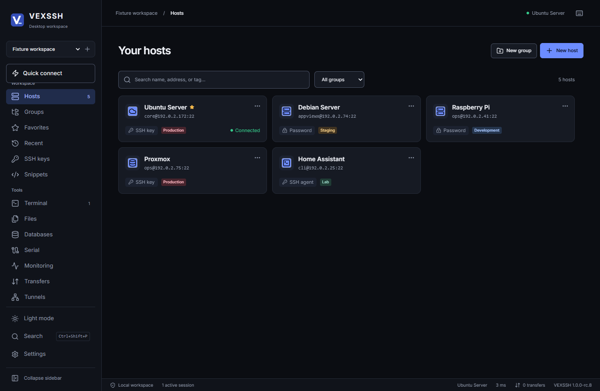
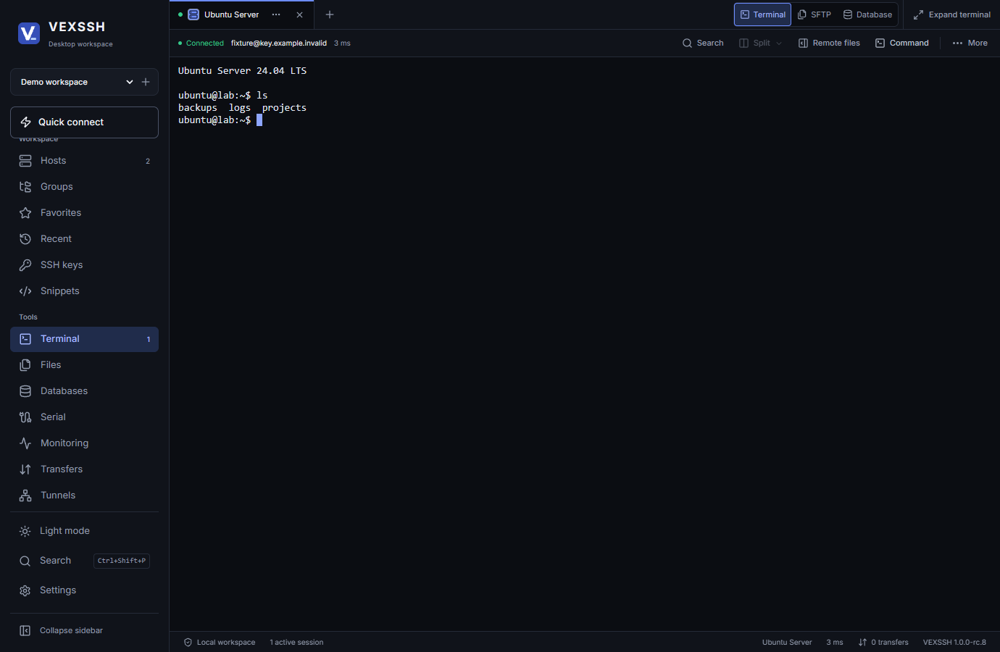
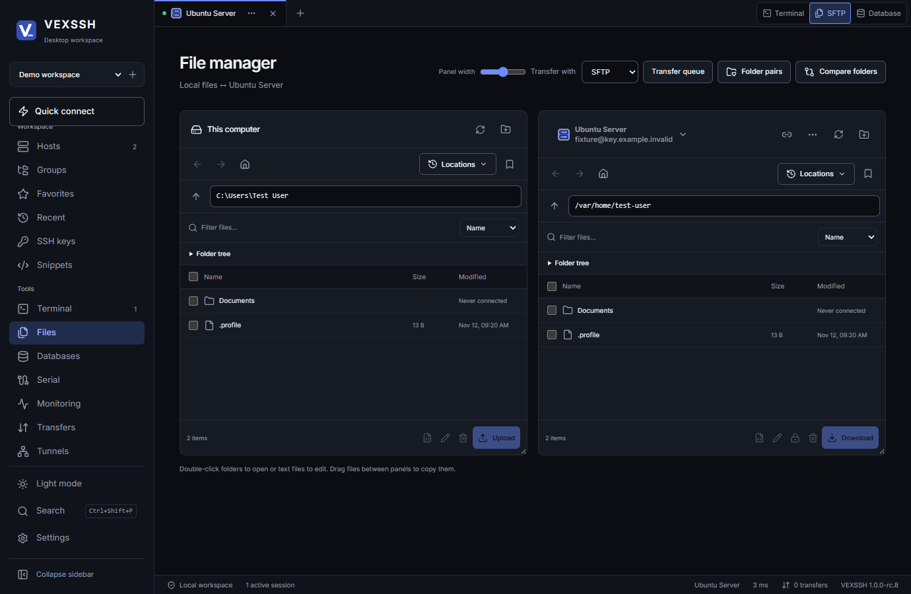
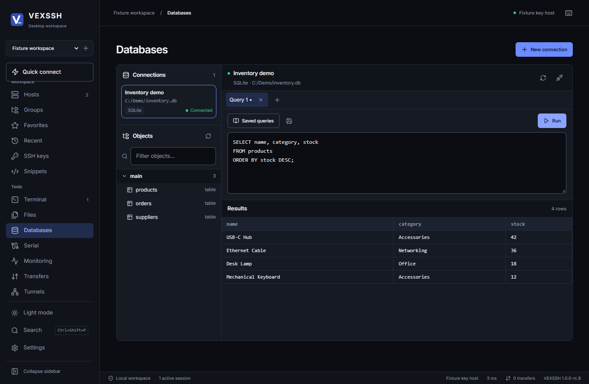
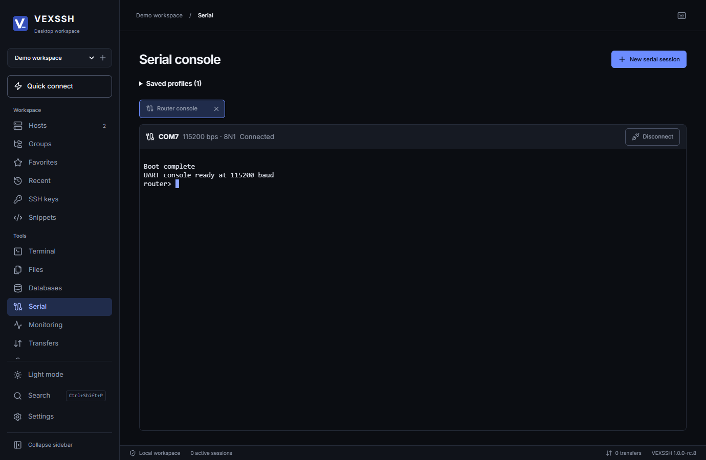

<p align="center">
  
</p>

<h1 align="center">VEXSSH</h1>

<p align="center">SSH · SFTP/SCP · Serial · Databases</p>

<p align="center"><a href="#preview">Screenshots</a> · <a href="#download">Download</a></p>

VEXSSH is a Windows app for working with servers and serial devices. Open a saved host, switch to SFTP to move or edit files, then return to the same shell.

## Preview

Screenshots from RC8 with sample connections.

### Saved hosts



*Hosts view with sample connections for Ubuntu Server, Debian Server, Raspberry Pi, Proxmox, and Home Assistant.*

### SSH terminal



### SFTP file manager



### Databases



*Database workspace with a sample SQLite inventory.*

### Serial console



## What it does

- **SSH** with saved hosts, tabs, split panes, and server fingerprint verification. Sign in with a password, an OpenSSH private key, or an SSH agent.
- **SFTP and SCP** for transfers between your computer and a remote host. Drop files or folders from Explorer onto the remote path field to upload to the open directory. Check transfer progress and resume eligible interrupted SFTP transfers.
- **Serial** for Windows COM ports. The port list updates when a USB adapter is plugged in or removed. The selector shows device information reported by Windows. Save the baud rate, parity, stop bits, and flow control for each device.
- **Databases** with a query editor and object browser. Connect directly or through an existing SSH session. SQLite opens a local file.

## Application appearance

Open **Settings → Appearance**, select a theme, and choose **Save changes**. Midnight, Graphite, Forest, and Dusk have dark backgrounds. Paper and Mist have light backgrounds. The choice applies across the workspace, including the sidebar, SFTP file manager, database tools, and serial console. Choose **System** to follow Windows.

Use the full-screen button or **F11** in SSH, SFTP, Serial, and database sessions. Press **F11** again to return to your previous window size. The session stays open.

## Terminal appearance

Open **Settings → Terminal** to choose a palette and font for SSH and serial consoles. Midnight, Graphite, Forest, and Dusk have dark backgrounds. Paper has a warm light background. JetBrains Mono and IBM Plex Mono are included in the app and work offline.

Use the color picker or enter a hex value to change ordinary terminal text. Programs can still set their own ANSI colors. SSH terminal profiles can override the global text color. [JetBrains Mono license](public/licenses/JetBrains-Mono.txt) · [IBM Plex Mono license](public/licenses/IBM-Plex-Mono.txt)

## Download

For Windows x64, use [Online Setup or Portable from the RC10 release](../../releases/tag/v1.0.0-rc.10).

RC10 is unsigned. Download from the release page and compare the file with its entry in **SHA256SUMS.txt** using PowerShell:

```powershell
Get-FileHash .\VEXSSH-1.0.0-rc.10-Windows-x64-Online-Setup.exe -Algorithm SHA256
```

A matching hash confirms that the file matches the published build. Windows SmartScreen and Chrome may still display a reputation warning for an unfamiliar download.

Previous downloads include [RC9](../../releases/tag/v1.0.0-rc.9), [RC8](../../releases/tag/v1.0.0-rc.8) and [RC7](../../releases/tag/v1.0.0-rc.7).

## Application data

The RC10 Windows download uses the same profile and vault locations as RC7 and RC8. To build the Windows release with those locations, check out the `v1.0.0-rc.10` tag. Development builds from `main` use their own storage.

## Run on Windows

VEXSSH uses Microsoft Edge WebView2. The Windows x64 installer can download the runtime when needed. The portable executable requires WebView2 to be installed already.

For a first SSH session, open **Hosts**, add your server, and verify its fingerprint when prompted. Use **Terminal** and **SFTP** in the session bar to switch between the shell and files.

## Build from source

Install Node.js, Rust with the MSVC toolchain, Microsoft C++ Build Tools with a Windows SDK, WebView2, Go 1.26 or later, and Strawberry Perl. Make sure Go and Perl are on your PATH.

```powershell
npm ci
npm run desktop
```

Run the frontend tests and build the Windows executable with:

```powershell
npm test
npm run tauri -- build --no-bundle
```

The executable is written to `src-tauri/target/release/vexssh.exe`. The frontend uses React and TypeScript. Tauri and Rust handle the desktop app, and a Go helper provides database drivers.

Maintainers can [build a signed Windows release](tools/windows/README.md) with their publisher certificate.

## Credits

Created by [FishyBite](https://github.com/FishyBite).
