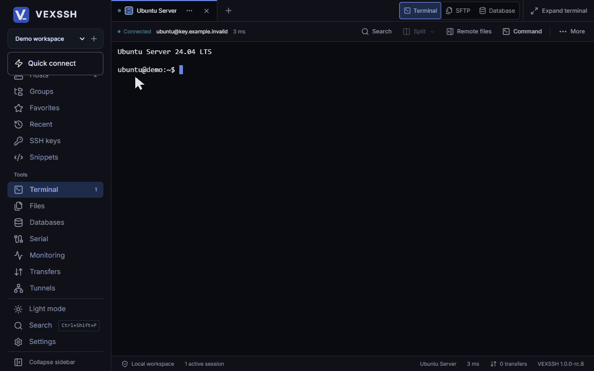

<p align="center">
  
</p>

<h1 align="center">VEXSSH</h1>

<p align="center">SSH · SFTP/SCP · Serial · Databases</p>

<p align="center"><a href="#preview">Screenshots</a> · <a href="#download">Download</a></p>

VEXSSH is a Windows app for working with servers and serial devices. Open a saved host, switch to SFTP to move or edit files, then return to the same shell.

## Terminal to SFTP

Type ls -la in the terminal, click SFTP to browse the host's files, then return to the same SSH session. The demo uses a sample Ubuntu connection.

<details>
<summary>Watch the 9-second demo</summary>



</details>


## Preview

Screenshots from RC8 with sample connections.

### Saved hosts


*Hosts view with sample connections for Ubuntu Server, Debian Server, Raspberry Pi, Proxmox, and Home Assistant.*

### SSH terminal


### SFTP file manager


### Databases


*Database workspace with a sample SQLite inventory.*

### Serial console


## What it does

- **SSH** with saved hosts, tabs, split panes, and server fingerprint verification. Sign in with a password, an OpenSSH private key, or an SSH agent.
- **SFTP and SCP** for transfers between your computer and a remote host. Drag files across panes, check transfer progress, and resume eligible interrupted SFTP transfers.
- **Serial** for Windows COM ports. Save the baud rate, parity, stop bits, and flow control for each device.
- **Databases** with a query editor and object browser. Connect directly or through an existing SSH session. SQLite opens a local file.

## Download

For Windows x64, use [Online Setup or Portable from the RC8 release](../../releases/tag/v1.0.0-rc.8).

**Older versions:** [RC7](../../releases/tag/v1.0.0-rc.7).

## Application data

The RC8 download uses the same profile and vault locations as RC7. Builds from the current `main` branch use separate storage. Keep your existing build if you need to open older profiles or backups.

## Run on Windows

VEXSSH uses Microsoft Edge WebView2. The Windows x64 installer can download the runtime when needed. The portable executable requires WebView2 to be installed already.

For a first SSH session, open **Hosts**, add your server, and verify its fingerprint when prompted. Use **Terminal** and **SFTP** in the session bar to switch between the shell and files.

## Build from source

Install Node.js, Rust with the MSVC toolchain, Microsoft C++ Build Tools with a Windows SDK, WebView2, Go 1.26 or later, and Strawberry Perl. Make sure Go and Perl are on your PATH.

```powershell
npm ci
npm run desktop
```

Run the frontend tests and build the Windows executable with:

```powershell
npm test
npm run tauri -- build --no-bundle
```

The executable is written to `src-tauri/target/release/vexssh.exe`. The frontend uses React and TypeScript. Tauri and Rust handle the desktop app, and a Go helper provides database drivers.

## Credits

Created by [FishyBite](https://github.com/FishyBite).
